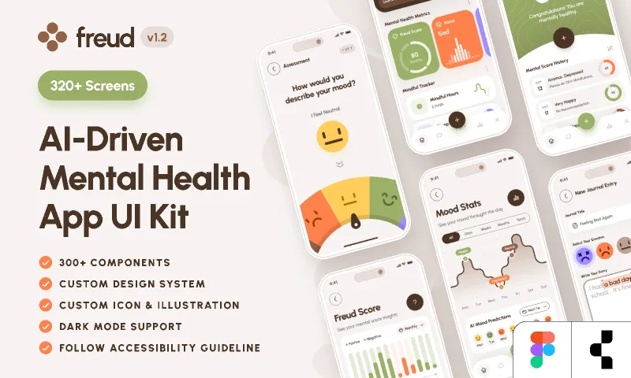

# 🌿 Freud — AI-Driven Mental Health & Wellness App

> A production-grade, full-fidelity implementation bringing the **Freud UI Kit (v1.2)** by Strange Helix from Figma to life. Built with React 19, TypeScript, Vite, Tailwind CSS, and Framer Motion.



---

## ✨ Features

### 1. 🎯 Interactive Assessment Flow
* **Clinical 7-Step Diagnostic**: Guided mental health evaluation measuring mood, anxiety, physical tension, sleep quality, and self-compassion.
* **Semi-Circular Radial Mood Dial**: Custom SVG radial arc with draggable needle physics and dynamic haptic feedback.
* **Expressive Reactive Emoji**: Animated face that smoothly morphs its eyes and mouth curvature as the dial turns.

### 2. 📊 Mental Health Metrics Dashboard
* **Freud Score Ring**: Dynamic circular SVG progress gauge displaying the user's overall mental health score (0–100).
* **Mood Soundwave Visualizer**: Animated rhythmic audio waves reflecting current emotional state.
* **Mindful Tracker**: Interactive logger for tracking daily mindfulness practice with SVG sparkline trends.

### 3. 📈 Mood Stats & AI Predictions
* **Cubic Bézier Spline Chart**: Smooth emotional journey curve tracking shifts across Monday through Sunday.
* **Pinned Milestone Badges**: Visual indicator tags (`Happy`, `Neutral`, `Depressed`) anchored to key wave peaks and valleys.
* **AI Mood Predictions**: Circadian rhythm forecast predicting emotional peaks and dips with proactive grounding tips.

### 4. ✍️ Mindful Journaling
* **Emotion Selector**: Six emotional states (Anxious, Sad, Neutral, Calm, Happy, Joyful) with tactile feedback.
* **Theme Tagging**: Category filters for identifying stress triggers (Work, Academic Pressure, Sleep, Gratitude).
* **AI Cognitive Reframing**: Real-time supportive analysis offering psychological grounding and compassionate reframing.

### 5. 💬 Freud AI Companion & Grounding
* **Empathetic AI Therapist**: Context-aware therapist companion trained on CBT principles.
* **Box Breathing Guide (4-4-4-4)**: Pulsing visual meditation guide (Inhale 4s, Hold 4s, Exhale 4s, Rest 4s).
* **Female Voice TTS Engine**: Soothing speech synthesis strictly utilizing female voice profiles (`Ava` / `Gadis` / `Jenny`).

### 6. 🏆 Score History & Milestone Ledger
* **Milestone Banner**: Celebratory status banner with topographical contour accents.
* **Positive vs. Negative Distribution**: Dual-bar monthly column chart comparing emotional balance.
* **Assessment Ledger**: Chronological history tracking diagnostic scores and personalized recommendations.

### 7. 📱 Device Simulator & Theming
* **iPhone 15/16 Pro Frame**: Authentic mobile preview with Dynamic Island, iOS status bar, and home indicator.
* **Responsive Desktop Mode**: Edge-to-edge expanded view for larger screens.
* **Dark / Light Mode**: Full theme switching adhering to Freud's organic color palette.

---

## 🛠️ Tech Stack

* **Framework**: React 19, TypeScript, Vite 6
* **Styling**: Tailwind CSS
* **Animations**: Framer Motion
* **Icons**: Lucide React
* **Speech Synthesis**: Web Speech API (Female Voice Enforced)
* **Design System**: Freud v1.2 Design Tokens (Strange Helix)

---

## 🚀 Getting Started

### Prerequisites
* Node.js 18+ (tested on Node v22)
* npm 9+

### Installation

```bash
# Clone the repository
git clone https://github.com/yosedie/freud.git

# Enter the directory
cd freud

# Install dependencies
npm install

# Start the development server
npm run dev
```

Visit `http://localhost:5173` in your browser.

### Building for Production

```bash
npm run build
```

---

## 📄 License

MIT License. Designed with inspiration from the Freud UI Kit by Strange Helix.
